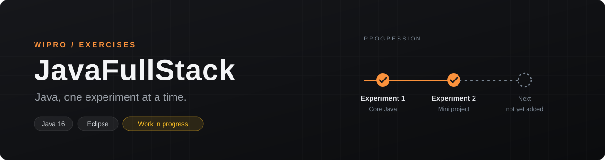

<div align="center">



<br />

**Java Full Stack (WIPRO) exercises**, organised one experiment at a time.

<br />


[Progress](#progress) · [Experiment 1](#experiment-1-core-java-basics) · [Experiment 2](#experiment-2-employee-salary-mini-project) · [Running the code](#running-the-code) · [Structure](#repository-structure)

</div>

<br />

> [!NOTE]
> **Work in progress.** The repository currently contains core Java only: Experiment 1 (six console programs) and Experiment 2 (a command-line mini project). It does not yet contain any web, framework, database or front-end code, and there are no automated tests.

## Progress

| Experiment | Package | Programs | Concepts | Status |
| --- | --- | --- | --- | --- |
| **1** | `Exp1` | `LC1`, `LC2`, `LC3`, `LC4`, `LC5_1`, `LC5_2` | Console input, loops, arrays, strings, sorting | Complete |
| **2** | `Exp2` | `miniproject` | Parallel arrays, `switch`, command-line arguments | Complete |

## Experiment 1: core Java basics

Six small console programs in [`src/Exp1/`](src/Exp1). Programs that read input use `java.util.Scanner`.

| Program | What it does | Concepts |
| --- | --- | --- |
| [`LC1`](src/Exp1/LC1.java) | Reads two integers and swaps them using a temporary variable | Variables, assignment |
| [`LC2`](src/Exp1/LC2.java) | Prints the digits of a number, last digit first | `while` loop, `%` and `/` |
| [`LC3`](src/Exp1/LC3.java) | Reads 10 integers, prints their sum and how many are above the average | Arrays, casting, two passes |
| [`LC4`](src/Exp1/LC4.java) | Prints the length of a line of text with spaces removed | `String.replace`, `length` |
| [`LC5_1`](src/Exp1/LC5_1.java) | Merges two sorted arrays into one sorted array | Two-pointer merge |
| [`LC5_2`](src/Exp1/LC5_2.java) | Reads 5 integers and sorts them | Bubble sort |

<details>
<summary><b>Example runs</b></summary>

```text
LC1   Enter value of A: 5          LC2   Enter the Number: 4821
      Enter value of B: 9                1
      After Swapping:                    2
      A = 9                              8
      B = 5                              4

LC3   input: 1 2 3 4 5 6 7 8 9 10  ->  Sum: 55, Greater than average: 5
LC4   input: hello java world      ->  Length of the string is 14
LC5_1 (fixed arrays)               ->  Merged Array: 1 2 3 4 5 6 7 8 9 10
LC5_2 input: 42 7 19 3 25          ->  Sorted Array: 3 7 19 25 42
```

</details>

## Experiment 2: employee salary mini project

[`Exp2/miniproject.java`](src/Exp2/miniproject.java) looks up an employee by ID, passed as a command-line argument, and prints a one-line salary summary. Employee records are held in parallel arrays (number, name, joining date, designation code, department, basic pay, HRA and income tax).

The designation code selects a designation and a fixed dearness allowance (DA):

| Code | Designation | DA |
| :-: | --- | ---: |
| `e` | Engineer | 20,000 |
| `c` | Consultant | 32,000 |
| `k` | Clerk | 12,000 |
| `r` | Receptionist | 15,000 |
| `m` | Manager | 40,000 |

**Salary = basic + HRA + DA − income tax.**

```console
$ java -cp bin Exp2.miniproject 1003
Emp No  Emp Name    Department  Designation Salary
1003    Rahul       Acct        Clerk       29000

$ java -cp bin Exp2.miniproject 9999
There is no employee with empid : 9999

$ java -cp bin Exp2.miniproject
Please enter Employee ID
```

For employee 1003: 10,000 + 8,000 + 12,000 − 1,000 = 29,000. The seven employees in the data set are IDs 1001 to 1007. The joining dates are stored but not used yet.

## Running the code

**Requirements:** JDK 16 or later. The Eclipse project is set to Java 16.

**In Eclipse.** Use *File → Import → Existing Projects into Workspace* and select this folder. Run any class as a Java Application. For `miniproject`, set the employee ID under *Run Configurations → Arguments*.

**From the command line**, in the repository root:

```bash
javac -d bin src/Exp1/*.java src/Exp2/*.java
java -cp bin Exp1.LC3
java -cp bin Exp2.miniproject 1001
```

`bin/` is git-ignored. The project also contains an empty `module-info.java`; compiling the packages directly as above does not need it.

## Repository structure

```text
JavaFullStack-WIPRO/
├── src/
│   ├── Exp1/              LC1, LC2, LC3, LC4, LC5_1, LC5_2
│   ├── Exp2/              miniproject
│   └── module-info.java   empty module descriptor
├── assets/readme/         README banner
├── .classpath, .project   Eclipse project files
└── .settings/             Eclipse compiler settings (Java 16)
```

---

<div align="center">
<sub>JavaFullStack-WIPRO · work in progress</sub>
</div>
